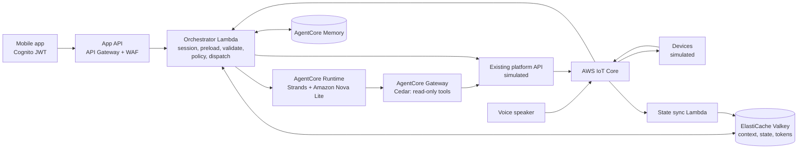

# Natural-language smart home control on Amazon Bedrock AgentCore

> **Prototype - for demonstration and learning only, not for production use.**
> * Deploy it only in a disposable, non-production AWS account.
> * You are responsible for everything you deploy from this repository, how you use it and the consequences,
>   including security, operation and costs.
> * Evaluate it with your own security and legal teams before any further use, following the
>   [AWS Shared Responsibility Model](https://aws.amazon.com/compliance/shared-responsibility-model/).
>
> Before any further use, work through the [production hardening checklist](docs/handover.md#production-hardening-checklist).

[中文说明](README.zh-CN.md)

A reference implementation for adding a "natural language -> structured plan -> validation -> dispatch"
path to an existing smart-home platform **without changing its device access, permission system or command
dispatch**. A lightweight model on Amazon Bedrock only interprets intent; deterministic code decides what is
allowed, and the existing control plane executes.

What it shows:
* **Existing control plane stays unchanged.** The agent returns a plan; the orchestrator dispatches through the
  platform's REST API. The agent's only tool (through AgentCore Gateway) is a read-only status query, and a
  default-deny Cedar policy on the gateway enforces that.
* **Context preloading**, so a control request needs a single model call.
* **Hard checks in code**: UUID whitelist, command and parameter ranges (non-finite numbers rejected),
  contradictions, action cap, fixed fallback for malformed output and for model or downstream failures.
* **Execution-layer sensitive-action policy** (unlock, disarm) with single-use, user-bound confirmation; voice
  requests are held for confirmation in the app.
* **Ambiguity guard** for same-named devices and remembered aliases; **deterministic memory write rules**;
  **reply text from control-plane acceptance results and fixed reason codes**, never from model prose; command
  receipts confirmed asynchronously.
* **Synthetic, versioned evaluation set** for all of the above, with a negative control that must fail; runnable
  offline or against a real model.

## Architecture

The mermaid source in [docs/architecture.md](docs/architecture.md) is the source of truth; it also covers the
request sequence, trust boundaries, deployment topology, design trade-offs and the fact-check table. Threat
model: [THREAT_MODEL.md](THREAT_MODEL.md).

## Prerequisites and costs
* A **disposable, non-production** AWS account and Region where Amazon Bedrock AgentCore and the configured model
  are available, with CDK bootstrap and the account-level API Gateway CloudWatch Logs role already in place
  (the stack does not change account-level settings; `make preflight` checks both).
* Python 3.12+ and [uv](https://docs.astral.sh/uv/), Node.js 20+, AWS CLI v2. No Docker: the agent is packaged
  as a zip with ARM64 wheels (AgentCore Runtime direct code deployment). Parameters:
  [docs/deployment-guide.md](docs/deployment-guide.md).
* **Costs.** You are responsible for the costs of what you deploy. Billing dimensions: model tokens
  ([Amazon Bedrock](https://aws.amazon.com/bedrock/pricing/)), Runtime / Memory / Gateway / Identity usage
  ([Amazon Bedrock AgentCore](https://aws.amazon.com/bedrock/agentcore/pricing/)), cache
  ([ElastiCache](https://aws.amazon.com/elasticache/pricing/)), NAT gateway hours and data
  ([Amazon VPC](https://aws.amazon.com/vpc/pricing/)), [AWS Lambda](https://aws.amazon.com/lambda/pricing/),
  [Amazon API Gateway](https://aws.amazon.com/api-gateway/pricing/), [AWS WAF](https://aws.amazon.com/waf/pricing/),
  [AWS IoT Core](https://aws.amazon.com/iot-core/pricing/), [Amazon DynamoDB](https://aws.amazon.com/dynamodb/pricing/),
  [Amazon Cognito](https://aws.amazon.com/cognito/pricing/),
  [AWS Secrets Manager](https://aws.amazon.com/secrets-manager/pricing/) and
  [Amazon CloudWatch](https://aws.amazon.com/cloudwatch/pricing/). No free-tier assumption is made. The NAT gateway
  and the serverless cache bill while the stack exists, so destroy it after testing. You can add an
  [AWS Budgets](https://docs.aws.amazon.com/cost-management/latest/userguide/budgets-create.html) alert for the
  account before deploying.

## Deploy
These are the only deployment commands in the repository; other documents refer to this section.
```bash
make init                                   # dependencies; creates config/sandbox.json from the template
make preflight                              # read-only; shows account ****NNNN and Region, asks you to confirm
make deploy                                 # preflight, cdk diff guard, deploy (config/sandbox.json)
make seed                                   # synthetic demo users and homes
```
* Non-interactive runs confirm the account with `CONFIRM_ACCOUNT=<last 4 digits>`.
* `make deploy` refuses a change set that deletes or replaces resources unless `ALLOW_DESTRUCTIVE=1` is set.
* Handover profile (data stores retained): `make deploy CONFIG=config/handover.json`, see
  [docs/handover.md](docs/handover.md).

## Use and verify
```bash
uv run python scripts/demo.py say "我要睡觉了"
ALLOW_PAID=1 make verify                    # end-to-end checks, including denial, cross-user and async paths
ALLOW_PAID=1 make eval-model                # evaluation set against the real model
```
Commands that invoke the model refuse to run without `ALLOW_PAID=1`. A healthy stack is not proof that the
application works: `make verify` checks that the controls take effect. Guided walkthrough:
[docs/demo-script.md](docs/demo-script.md). What was run, with date, Region, configuration, commit and what the
results do not prove: [VERIFICATION.md](VERIFICATION.md) and [DEPLOYMENT-LOG.md](DEPLOYMENT-LOG.md).

## Troubleshooting
* `make preflight` fails on VPC or Elastic IP headroom: choose another Region or free capacity; the stack needs one
  VPC and one Elastic IP per NAT gateway.
* `make preflight` reports no API Gateway CloudWatch Logs role: that is an account-level setting for the account
  owner (see [OPEN-QUESTIONS.md](OPEN-QUESTIONS.md)); the stack does not create it.
* Asset build fails: `uv` must reach PyPI to download ARM64 wheels; a package without an ARM64 wheel cannot be
  used in the agent (D26 in [DECISIONS.md](DECISIONS.md)).
* Requests return the fallback reply: check the orchestrator log for `preload_failed`, `agent_invocation_failed`,
  `plan_parse_failed` or `request_failed` (raw model output is logged there, never returned to users).

## Security and limitations
See [SECURITY.md](SECURITY.md) (what is deployed, data handling, controls and where they are implemented, known
considerations, hardening steps), [SECURITY-NOTES.md](SECURITY-NOTES.md) (trust policies and cdk-nag
acknowledgements with reasons) and the limits in
[docs/architecture.md](docs/architecture.md#limits-and-known-gaps). Open questions:
[OPEN-QUESTIONS.md](OPEN-QUESTIONS.md). Design decisions: [DECISIONS.md](DECISIONS.md). Standards review:
[docs/standards-review.md](docs/standards-review.md).

## Clean up
```bash
make destroy                                # asks twice: stack name, then data and bootstrap objects
make verify-cleanup                         # read-only; exits non-zero if anything is left
```
Not removed by `cdk destroy` alone (the cleanup script handles the first three):
* log groups that services create outside the stack (AgentCore Runtime, CDK provider functions);
* workload identities AgentCore created for the runtime and gateway;
* this project's asset objects (agent package, Lambda code, templates) in the **shared** CDK bootstrap S3
  bucket - identified by asset hash; CDK's generic provider packages and the CDKToolkit stack are never touched;
* with the handover profile, the retained DynamoDB tables, cache and memory;
* service-linked roles that AWS services create on first use (shared by the account).

Do not assume a completed command removed everything; check with `make verify-cleanup` in every Region you used
(`uv run python scripts/verify_cleanup.py --regions <REGION> ...`). Details: [docs/cleanup.md](docs/cleanup.md).

## Repository layout
```
src/core/smarthome_core/   cloud-agnostic domain logic (validation, policy, ambiguity, memory rules, orchestrator)
src/agent/                 Strands agent for AgentCore Runtime (direct code deployment, ARM64)
src/aws/smarthome_aws/     AWS adapters (Valkey with IAM auth, AgentCore Runtime/Memory, platform client, EMF)
src/functions/             Lambda handlers (orchestrator, simulated platform, virtual devices, state sync)
infra/                     AWS CDK app (Python) with cdk-nag and config validation
config/                    parameter templates (*.example.json); make init creates the git-ignored copies
local/                     in-memory fakes and local runner
scripts/                   preflight, deploy, eval, seed, demo, end-to-end test, cleanup, leftover check
sample-data/               synthetic homes and the versioned evaluation set
tests/                     unit, adapter, handler, config, cleanup-script and evaluator tests
docs/                      architecture, deployment, demo, handover, cleanup, prior art, standards review
```

## Test locally
No AWS account is needed:
```bash
make init
make lint test eval     # ruff, tests, evaluation set with the mock model and the negative control
make local              # full pipeline with in-memory fakes and a rule-based planner
make synth              # CloudFormation synth with cdk-nag, without AWS credentials
make scan               # gitleaks (history + canary), detect-secrets, zizmor, osv-scanner
```

## Contributing
See [CONTRIBUTING](CONTRIBUTING.md) for more information.

## Security
See [CONTRIBUTING](CONTRIBUTING.md#security-issue-notifications) and [SECURITY.md](SECURITY.md) for more
information.

## License
This library is licensed under the MIT-0 License. See the [LICENSE](LICENSE) file. Third-party components and
their licenses: [THIRD-PARTY-LICENSES.md](THIRD-PARTY-LICENSES.md).
