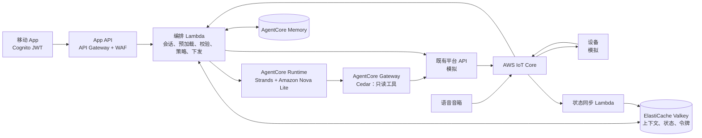

# 基于 Amazon Bedrock AgentCore 的智能家居自然语言控制

> **Prototype：仅用于演示和学习，不用于生产。**
> * 只部署在可随时丢弃的非生产 AWS 账号中。
> * 使用者对从本仓库部署的一切、使用方式及其后果负责，包括安全、运维和费用。
> * 继续使用之前，请与你自己的安全和法务团队评估，并遵循 [AWS 责任共担模型](https://aws.amazon.com/compliance/shared-responsibility-model/)。
>
> 继续使用之前，请先完成[上生产前需要加固的清单](docs/handover.md#production-hardening-checklist)。

[English](README.md)

这是一个参考实现：在**不改动**既有智能家居平台的设备接入、权限体系和指令下发的前提下，增加一条「自然语言 → 结构化计划 → 校验 → 下发」的链路。Amazon Bedrock 上的轻量模型只负责解释意图；允许做什么由确定性代码判断，执行仍走既有控制平面。

包含的内容：
* **既有控制平面不动**：Agent 只返回计划，编排器通过平台既有的 REST API 下发。Agent 唯一的工具（经 AgentCore Gateway）是只读的状态查询，Gateway 上默认拒绝的 Cedar 策略从外部保证这一点。
* **上下文预加载**：控制类请求只需一次模型调用。
* **代码级硬校验**：UUID 白名单、指令与参数范围（拒绝 NaN/Infinity）、矛盾动作、动作数量上限；模型输出非法、模型或下游出错时返回固定兜底文案。
* **执行层敏感动作策略**（开锁、撤防）：一次性、绑定用户的二次确认；语音发起的敏感动作挂起，需在 App 中确认。
* **同名设备与记忆别名的歧义拦截**、**确定性的记忆写入规则**、**回复文案只由控制平面的受理结果和固定原因码生成**，不使用模型原文；设备执行结果通过指令回执异步确认。
* **带版本的合成评测集**覆盖以上全部行为，并包含必须报失败的反例；可离线运行，也可接真实模型运行。

## 架构

以 [docs/architecture.md](docs/architecture.md) 中的 mermaid 源为准；该文档还包括请求时序、信任边界、部署拓扑、设计取舍和事实核对表。威胁模型见 [THREAT_MODEL.md](THREAT_MODEL.md)。

## 前置条件与成本
* 一个**可随时丢弃的非生产** AWS 账号，所选区域可用 Amazon Bedrock AgentCore 和所配置的模型，并已完成 CDK bootstrap、已设置账号级 API Gateway CloudWatch 日志角色（本栈不修改账号级设置；`make preflight` 会检查这两项）。
* Python 3.12+ 与 [uv](https://docs.astral.sh/uv/)、Node.js 20+、AWS CLI v2。不需要 Docker：Agent 以包含 ARM64 依赖的 zip 包部署（AgentCore Runtime 直接代码部署）。参数说明见 [docs/deployment-guide.md](docs/deployment-guide.md)。
* **成本**：所部署资源的费用由使用者承担。计费维度：模型 token（[Amazon Bedrock](https://aws.amazon.com/bedrock/pricing/)）、Runtime / Memory / Gateway / Identity 用量（[Amazon Bedrock AgentCore](https://aws.amazon.com/bedrock/agentcore/pricing/)）、缓存（[ElastiCache](https://aws.amazon.com/elasticache/pricing/)）、NAT 网关时长与流量（[Amazon VPC](https://aws.amazon.com/vpc/pricing/)）、[AWS Lambda](https://aws.amazon.com/lambda/pricing/)、[Amazon API Gateway](https://aws.amazon.com/api-gateway/pricing/)、[AWS WAF](https://aws.amazon.com/waf/pricing/)、[AWS IoT Core](https://aws.amazon.com/iot-core/pricing/)、[Amazon DynamoDB](https://aws.amazon.com/dynamodb/pricing/)、[Amazon Cognito](https://aws.amazon.com/cognito/pricing/)、[AWS Secrets Manager](https://aws.amazon.com/secrets-manager/pricing/) 和 [Amazon CloudWatch](https://aws.amazon.com/cloudwatch/pricing/)。不假设任何免费额度。NAT 网关和无服务器缓存在栈存在期间持续计费，测试完请及时销毁。部署前可以为账号设置 [AWS Budgets](https://docs.aws.amazon.com/cost-management/latest/userguide/budgets-create.html) 预算告警。

## 部署
仓库中只有这里写部署命令，其他文档都引用本节。
```bash
make init                                   # 安装依赖；从模板生成 config/sandbox.json
make preflight                              # 只读；显示账号 ****NNNN 和区域，并要求确认
make deploy                                 # preflight、cdk diff 保护、部署（config/sandbox.json）
make seed                                   # 写入合成的演示用户和家庭
```
* 非交互运行时用 `CONFIRM_ACCOUNT=<账号末 4 位>` 确认目标账号。
* 变更集会删除或替换资源时，`make deploy` 默认拒绝，需显式设置 `ALLOW_DESTRUCTIVE=1`。
* 交接配置（保留数据存储）：`make deploy CONFIG=config/handover.json`，见 [docs/handover.md](docs/handover.md)。

## 使用与验证
```bash
uv run python scripts/demo.py say "我要睡觉了"
ALLOW_PAID=1 make verify                    # 端到端检查，含拒绝、越权和异步路径
ALLOW_PAID=1 make eval-model                # 用真实模型跑评测集
```
会调用模型的命令在没有 `ALLOW_PAID=1` 时拒绝运行。栈部署成功不代表应用可用：`make verify` 会验证各项控制确实生效。演示脚本见 [docs/demo-script.md](docs/demo-script.md)。实际运行了什么（含日期、区域、配置、提交哈希，以及结果不能证明什么）见 [VERIFICATION.md](VERIFICATION.md) 和 [DEPLOYMENT-LOG.md](DEPLOYMENT-LOG.md)。

## 故障排查
* `make preflight` 提示 VPC 或弹性 IP 不足：换一个区域或释放容量；本栈需要 1 个 VPC，每个 NAT 网关需要 1 个弹性 IP。
* `make preflight` 提示没有 API Gateway CloudWatch 日志角色：这是账号级设置，由账号所有者决定（见 [OPEN-QUESTIONS.md](OPEN-QUESTIONS.md)）；本栈不会创建它。
* 资产构建失败：`uv` 需要能访问 PyPI 下载 ARM64 wheel；没有 ARM64 wheel 的包不能用在 Agent 里（见 [DECISIONS.md](DECISIONS.md) D26）。
* 请求返回兜底文案：在编排器日志中查找 `preload_failed`、`agent_invocation_failed`、`plan_parse_failed` 或 `request_failed`（模型原文只记录在日志里，不会返回给用户）。

## 安全与局限
见 [SECURITY.md](SECURITY.md)（部署了什么、数据处理、各项控制及其实现位置、已知注意事项、加固步骤）、[SECURITY-NOTES.md](SECURITY-NOTES.md)（信任策略与 cdk-nag 抑制理由）以及 [docs/architecture.md](docs/architecture.md#limits-and-known-gaps) 中的局限。待确认的问题见 [OPEN-QUESTIONS.md](OPEN-QUESTIONS.md)，设计决策见 [DECISIONS.md](DECISIONS.md)，规范对照表见 [docs/standards-review.md](docs/standards-review.md)。

## 清理
```bash
make destroy                                # 两次确认：先确认栈名，再确认删除数据和 bootstrap 对象
make verify-cleanup                         # 只读；有任何残留时以非零退出
```
只执行 `cdk destroy` 不会删除的（前三项由清理脚本处理）：
* 服务在栈外创建的日志组（AgentCore Runtime、CDK provider 函数）；
* AgentCore 为 Runtime 和 Gateway 创建的 workload identity；
* **共享** CDK bootstrap S3 桶中属于本项目的资产对象（Agent 代码包、Lambda 代码、模板）——按资产哈希识别；CDK 通用 provider 包和 CDKToolkit 栈不动；
* 使用 handover 配置时保留的 DynamoDB 表、缓存和 Memory；
* AWS 服务首次使用时创建的服务关联角色（账号共享）。

不要以为命令执行完就删干净了：在用过的每个区域运行 `make verify-cleanup`（`uv run python scripts/verify_cleanup.py --regions <REGION> ...`）。详见 [docs/cleanup.md](docs/cleanup.md)。

## 目录结构
```
src/core/smarthome_core/   与云无关的领域逻辑（校验、策略、歧义、记忆规则、编排）
src/agent/                 AgentCore Runtime 上的 Strands Agent（直接代码部署，ARM64）
src/aws/smarthome_aws/     AWS 适配器（IAM 认证的 Valkey、AgentCore Runtime/Memory、平台客户端、EMF）
src/functions/             Lambda 处理函数（编排、模拟平台、虚拟设备、状态同步）
infra/                     AWS CDK 应用（Python），含 cdk-nag 和配置校验
config/                    参数模板（*.example.json）；make init 生成不入库的副本
local/                     内存假实现和本地运行入口
scripts/                   预检、部署、评测、数据初始化、演示、端到端测试、清理、残留核对
sample-data/               合成的家庭数据和带版本的评测集
tests/                     单元、适配器、处理函数、配置、清理脚本和评测器测试
docs/                      架构、部署、演示、交接、清理、prior art、规范对照表
```

## 本地测试
不需要 AWS 账号：
```bash
make init
make lint test eval     # ruff、测试、mock 模型评测集和反例
make local              # 用内存假实现和规则规划器跑通全链路
make synth              # 带 cdk-nag 的 CloudFormation synth，不需要 AWS 凭证
make scan               # gitleaks（全历史 + canary）、detect-secrets、zizmor、osv-scanner
```

## Contributing
详见 [CONTRIBUTING](CONTRIBUTING.md)。

## Security
详见 [CONTRIBUTING](CONTRIBUTING.md#security-issue-notifications) 和 [SECURITY.md](SECURITY.md)。

## License
本项目采用 MIT-0 许可证，见 [LICENSE](LICENSE) 文件。第三方组件及其许可证见 [THIRD-PARTY-LICENSES.md](THIRD-PARTY-LICENSES.md)。
