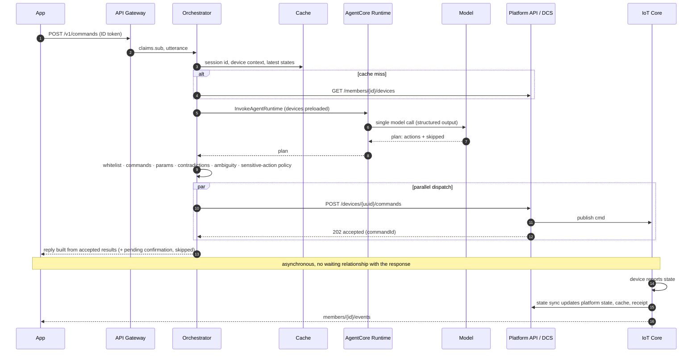

# Architecture

## Goal and constraints

Add a "natural language -> structured plan -> validation -> dispatch" path to a smart-home SaaS platform
**without changing** its device access, permission system or command dispatch.

Hard constraints taken as requirements:

1. **Acceptance latency** (request received by the backend -> acceptance response returned to the app, not
   including physical execution on the device) has a P95 target. The target is a parameter
   (`acceptanceLatencyTargetMs` in the config file); the dashboard and alarm use it.
2. **No re-architecture** of the existing platform: it is reached only through its existing REST API.
3. **Unlock-type actions are never triggered automatically** by natural language.

## Components

```mermaid
flowchart LR
  subgraph Clients
    APP[Mobile app<br/>(demo CLI)]
    SPK[Voice speaker<br/>(IoT device)]
  end
  subgraph Edge
    WAF[AWS WAF]
    APIGW[API Gateway REST<br/>Cognito authorizer]
    IOTC[AWS IoT Core<br/>rules]
  end
  subgraph Request path
    ORCH[Orchestrator Lambda<br/>session · preload · validate · policy · dispatch · reply]
    CACHE[(ElastiCache Serverless<br/>Valkey · IAM auth)]
  end
  subgraph AgentCore
    RT[AgentCore Runtime<br/>Strands agent]
    MEM[(AgentCore Memory)]
    GW[AgentCore Gateway<br/>OpenAPI target]
    ID[AgentCore Identity<br/>OAuth2 + API key providers]
  end
  BR[Amazon Bedrock<br/>Amazon Nova Lite]
  subgraph Existing platform [Existing platform - simulated, unchanged]
    PAPI[Platform REST API<br/>API key]
    DCS[Device control service<br/>Lambda]
    DDB[(Devices · members<br/>commands · speakers)]
  end
  DEV[Virtual devices<br/>Lambda]
  SYNC[State sync Lambda]

  APP -->|JWT| WAF --> APIGW --> ORCH
  SPK -->|utterance topic| IOTC --> ORCH
  ORCH <--> CACHE
  ORCH -->|SigV4 + runtimeUserId| RT
  RT --> BR
  RT <--> MEM
  RT -->|M2M token from Identity| GW -->|API key from Identity| PAPI
  ORCH -->|validated actions, parallel| PAPI --> DCS --> DDB
  DCS -->|cmd topic| IOTC --> DEV
  DEV -->|state topic| IOTC --> SYNC
  SYNC --> DDB
  SYNC --> CACHE
  SYNC -->|user events topic| IOTC
  ORCH -->|preference writes| MEM
```

| Component | Responsibility |
|---|---|
| API Gateway (app) | Authenticates users with Cognito, validates request bodies, throttles. WAF in front. |
| Orchestrator Lambda | The only component on the waiting path: gets the session, preloads device context, calls the agent once, runs validation, ambiguity guard and sensitive-action policy, dispatches in parallel, builds the reply, writes governed preferences. |
| ElastiCache (Valkey) | Preloaded device lists, latest reported state, session ids, confirmation tokens, idempotency records. |
| AgentCore Runtime | Hosts the Strands agent. Reads preferences and recent turns from Memory, returns a JSON plan. Its only tool is a read-only status query through the Gateway. |
| AgentCore Memory | Short-term events (actor = user, session = runtime session). Long-term preference and alias records written by the orchestrator under `/members/<id>/preferences/` with metadata and expiry. |
| AgentCore Gateway + Identity | Wraps the platform REST API as MCP tools from its OpenAPI description. Inbound: Cognito M2M JWT obtained by the agent through an Identity OAuth2 credential provider. Outbound: API key held by an Identity API-key credential provider. |
| Simulated platform | Device directory, membership authorisation, independent command validation, command log, publishing to device topics. Stands in for the real platform; replace it in an integration. |
| Virtual devices / state sync | Simulate devices on AWS IoT Core and carry reported state back to the platform, the cache and the app's event topic. |

## Request path ("我要睡觉了")



Design choices on this path:

* **Preloading** removes the model's "list devices" tool round trip, so a control request needs one model
  call. This is a request-orchestration choice and works the same without a managed runtime.
* **Acceptance, not execution.** The response returns once the control service has accepted the commands.
  The reply says "已下发" (dispatched). Execution is confirmed by command receipts updated from device reports.
* **Model message is not a receipt.** For control plans the model's `message` is discarded; the reply is built
  from dispatch results, including failures, held actions and skipped devices.

## Hard checks (application layer)

| Check | Where | Behaviour |
|---|---|---|
| UUID whitelist | `validation.py` | Only devices in the caller's preloaded context. Others rejected and counted. |
| Command range | `validation.py`, `catalog.py` | Action must exist for the device type; parameters known, typed, in range, required ones present. |
| Contradictions / duplicates / cap | `validation.py` | Opposite actions on one device are dropped and the user is asked; duplicates collapsed; action count capped. |
| Same-name ambiguity | `ambiguity.py` | If the utterance names a device whose name or app alias is not unique and does not disambiguate it, no action is taken; the user is asked. |
| Sensitive actions | `policy.py` | Defined per action: `lock.unlock`, `security_system.disarm`. Always held; confirmed only on the app API with a single-use, user-bound, short-lived token. |
| Malformed output | `models.py`, `orchestrator.py` | Fixed fallback reply; raw output only in logs; counted. Runtime or model errors get the same fallback, never an error status. |
| Narrow normalisation | `validation.py` | Digit-only strings for integer parameters become integers; `turnOn` with one value parameter becomes the matching `set*` action. Nothing else is rewritten. |
| Platform validation | `platform_api/handler.py` | The platform independently re-validates commands and membership. |
| Gateway policy | Cedar policy engine (`stack.py`) | Default deny; only the read-only tools are permitted for the agent's tokens. `controlDevice` cannot be called through the gateway. |
| Runtime access | Runtime resource policy (`stack.py`) | Only the orchestrator role may invoke the runtime or assert a user id. |

## Memory governance

| Rule | Implementation |
|---|---|
| Only explicit preferences | Taste parameters (brightness, colour temperature, target temperature, volume) of *accepted* actions, only if the value appears in the utterance; values the model took from preferences are never written back. Relative requests ("调暗一点") write nothing. |
| One version per device and attribute | Before writing, existing records for the same `deviceUuid` + `attribute` (metadata filter) are deleted. Listing is eventually consistent, so reads keep only the newest record per device and attribute, and later writes remove any leftovers. |
| Ageing | Records are created with an expiry (`preferenceTtlDays`, configurable). |
| Aliases | Stored as auxiliary context, must map to a permitted device, cannot shadow an authoritative device name or app alias. |
| Single writer | Only the orchestrator writes long-term records; the runtime role can only list records and write conversation events. |
| Off the waiting path | The orchestrator sends preferences with the request (cache-backed, invalidated on write); recent turns are kept in the runtime session's microVM. Memory is read only on a cache miss or a new microVM. |

## Observability

* Orchestrator emits CloudWatch EMF metrics per request: `LatencyTotal`, `LatencyPreload`, `LatencyInference`,
  `LatencyDispatch`, cache hit/miss, actions dispatched/failed/rejected, sensitive actions held, ambiguous
  references, parse failures, model input/output tokens and agent tool calls (returned by the runtime).
* Dashboard `<prefix>-dashboard` and an alarm on `LatencyTotal` P95 above the configured target.
* The agent runs under the ADOT auto-instrumentation (`opentelemetry-instrument` entry point). Viewing AgentCore spans in CloudWatch
  requires CloudWatch Transaction Search, an account-level setting this stack does not change.
* Device-side receipts: the command log records `accepted` and later `executed` from device reports, which is
  the part AgentCore observability does not cover.

### How to measure acceptance latency
Percentiles of segments cannot be added. Measure end to end independently:
`scripts/e2e_test.py --latency-samples N` sends N control requests and records, for each, the server-side
`timings_ms.total` (Lambda receipt to response) and the client round trip; it reports P50/P95 of each series
in `.build/e2e-report.json` and checks the server-side P95 against `acceptanceLatencyTargetMs`. In production,
use the `LatencyTotal` P95 metric over real traffic.

## Limits and known gaps
* Scene semantics are model judgement (for example dimming instead of switching off a light). Hard checks
  bound *safety*, not *taste*.
* Free-text replies for `query` and `chat` come from the model (length-capped).
* Cross-request conflicts (two different requests in quick succession) are not detected.
* The voice channel in the prototype is driven with developer IAM credentials, not device certificates.
* The model's `params_source` label proved unreliable in testing; it is only used to *exclude* values taken
  from preferences.
* In the tested configuration the acceptance-latency P95 was above the configured target; the model call is
  the largest share. See VERIFICATION.md for the method and what was tried.
* Writing a memory record with an expiry required the IAM action
  `bedrock-agentcore:UpdateMemoryRecordExpirySpecification` in testing; it is granted to the orchestrator.
* Only overseas (non-China) AWS Regions are targeted; AgentCore is not listed for the China Regions (see below).

## Fact check

Verified against official documentation on 2026-10-20.

| Statement used in this repository | Source |
|---|---|
| Each AgentCore Runtime session runs in its own microVM; AgentCore does not map sessions to users, the client backend must. | [Use isolated sessions for agents](https://docs.aws.amazon.com/bedrock-agentcore/latest/devguide/runtime-sessions.html) |
| Runtime session ids must be at least 33 characters. | [Use isolated sessions for agents](https://docs.aws.amazon.com/bedrock-agentcore/latest/devguide/runtime-sessions.html) |
| HTTP protocol contract: port 8080, `/invocations`; SigV4 or OAuth inbound. | [Runtime service contract](https://docs.aws.amazon.com/bedrock-agentcore/latest/devguide/runtime-service-contract.html) |
| Passing a user id (`X-Amzn-Bedrock-AgentCore-Runtime-User-Id` / `runtimeUserId`) requires `bedrock-agentcore:InvokeAgentRuntimeForUser`; the value is not verified by AgentCore and must be derived from an authenticated principal. | [Inbound and outbound auth](https://docs.aws.amazon.com/bedrock-agentcore/latest/devguide/runtime-oauth.html) |
| A runtime supports either SigV4 or JWT inbound auth, not both; a workload identity is created automatically. | [Inbound and outbound auth](https://docs.aws.amazon.com/bedrock-agentcore/latest/devguide/runtime-oauth.html) |
| Gateway OpenAPI targets support OpenAPI 3.0/3.1; `operationId` becomes the tool name; servers URL must be the real endpoint; outbound auth can be an API key or OAuth credential provider from AgentCore Identity in the same account and Region; oneOf/anyOf/allOf unsupported. | [OpenAPI schema targets](https://docs.aws.amazon.com/bedrock-agentcore/latest/devguide/gateway-schema-openapi.html) |
| Gateway tool names are `<target>___<operationId>`. | [Call a tool in a gateway](https://docs.aws.amazon.com/bedrock-agentcore/latest/devguide/gateway-using-mcp-call.html) |
| Memory organises short-term events by actor and session; long-term records live in namespaces that should start and end with `/`. | [Memory organization](https://docs.aws.amazon.com/bedrock-agentcore/latest/devguide/memory-organization.html) |
| `BatchCreateMemoryRecords` accepts namespaces, metadata and a record expiry specification; `ListMemoryRecords` supports metadata filters. | AWS SDK service model `bedrock-agentcore` (boto3 1.43.115), operations `BatchCreateMemoryRecords`, `ListMemoryRecords`, `BatchDeleteMemoryRecords` |
| Viewing AgentCore spans in CloudWatch requires CloudWatch Transaction Search; agents use ADOT (`aws-opentelemetry-distro>=0.18.0`) and `opentelemetry-instrument`. | [Add observability](https://docs.aws.amazon.com/bedrock-agentcore/latest/devguide/observability-configure.html) |
| AgentCore Runtime, Memory, Gateway, Identity and Observability are available in us-east-1; the Region table lists no China Regions. | [Supported AWS Regions](https://docs.aws.amazon.com/bedrock-agentcore/latest/devguide/agentcore-regions.html) |
| Nova Lite model id `amazon.nova-lite-v1:0`; US geo inference profile `us.amazon.nova-lite-v1:0` (from us-east-1 routes to us-east-1, us-east-2, us-west-2); Converse API and client-side tool calling supported; Bedrock's native "structured outputs" feature not supported. This repository gets structured output through tool calling (Strands `structured_output_model`). | [Nova Lite model card](https://docs.aws.amazon.com/bedrock/latest/userguide/model-card-amazon-nova-lite.html) |
| ElastiCache IAM auth: Valkey 7.2+; TLS required; user id must equal user name; tokens valid 15 minutes; connections disconnected after 12 hours; requires `elasticache:Connect` on the cache and the user; serverless token requests include `ResourceType=ServerlessCache`. | [Authenticating with IAM](https://docs.aws.amazon.com/AmazonElastiCache/latest/dg/auth-iam.html) |
| Policy in AgentCore: engines associated with a gateway evaluate every tool call; default-deny and forbid-wins; `AgentCore::OAuthUser` principals come from the JWT `sub` with JWT claims as tags; the gateway execution role needs `AuthorizeAction`, `PartiallyAuthorizeActions` (on the engine and the gateway) and `GetPolicyEngine`; gateway modes `LOG_ONLY` / `ENFORCE`. | [Policy core concepts](https://docs.aws.amazon.com/bedrock-agentcore/latest/devguide/policy-core-concepts.html), [Policy IAM permissions](https://docs.aws.amazon.com/bedrock-agentcore/latest/devguide/policy-permissions.html); CloudFormation schema `AWS::BedrockAgentCore::Gateway` (`PolicyEngineConfiguration.Mode`) |
| Runtime `LifecycleConfiguration` has `IdleRuntimeSessionTimeout` and `MaxLifetime`; sessions stop on inactivity (default 15 minutes) or at max lifetime (default 8 hours). | CloudFormation schema `AWS::BedrockAgentCore::Runtime`; [Use isolated sessions for agents](https://docs.aws.amazon.com/bedrock-agentcore/latest/devguide/runtime-sessions.html) |
| Strands Agents is hosted on AgentCore Runtime through the `bedrock-agentcore` SDK's `BedrockAgentCoreApp` entrypoint (HTTP contract above). | [Runtime service contract](https://docs.aws.amazon.com/bedrock-agentcore/latest/devguide/runtime-service-contract.html); `bedrock-agentcore` 1.24.2 package |
